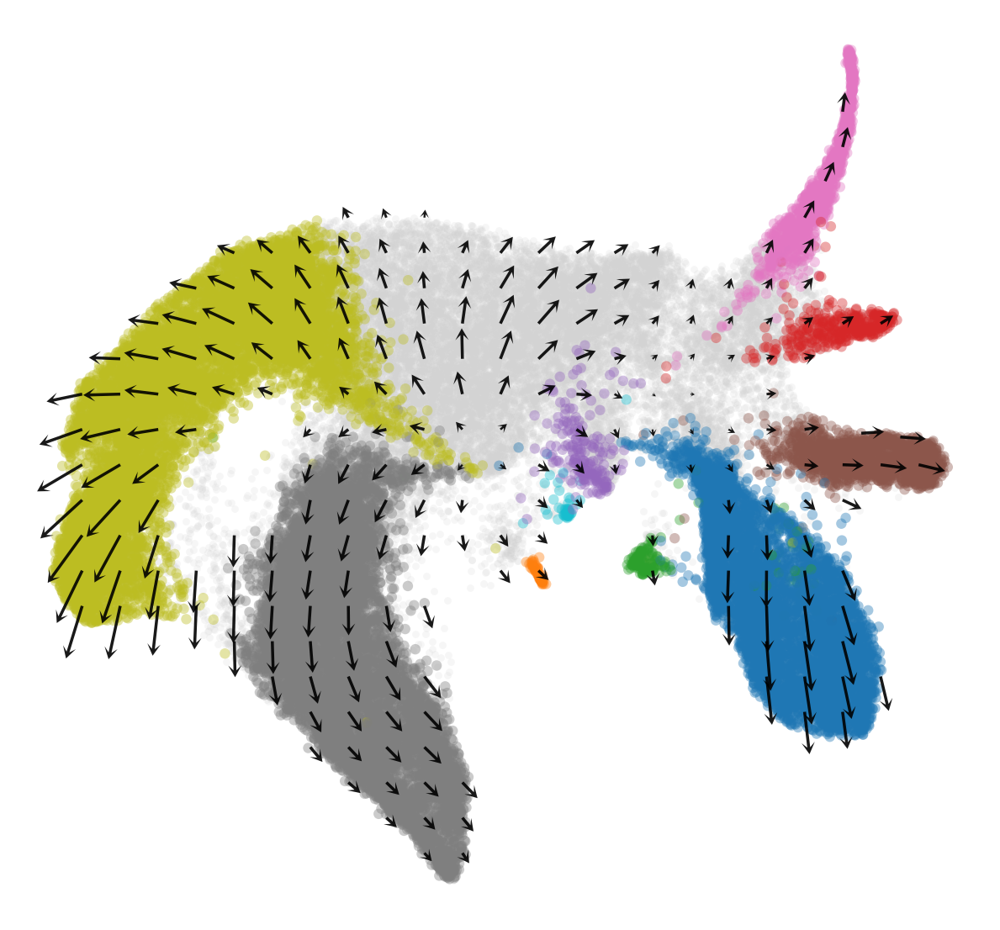
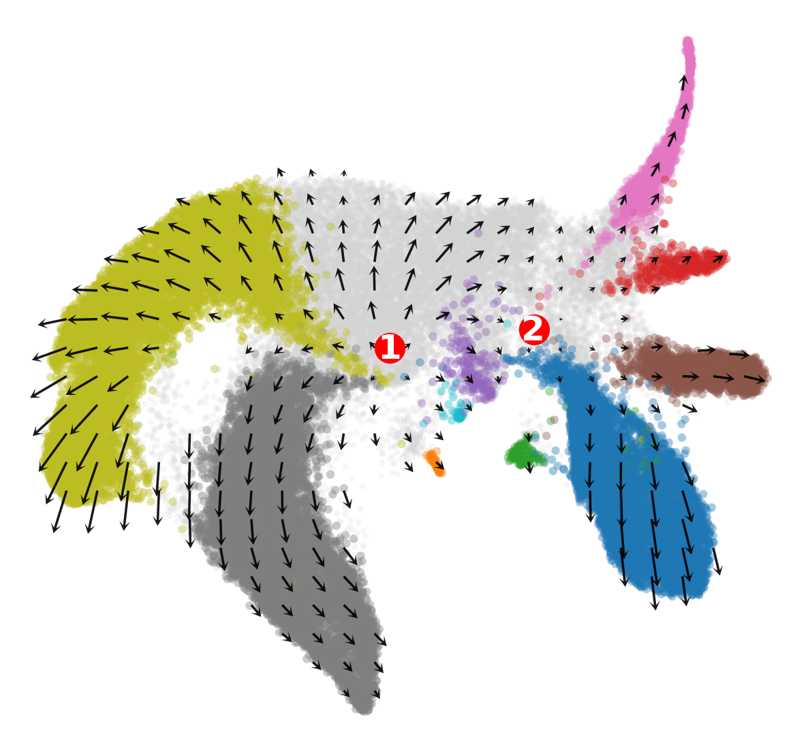
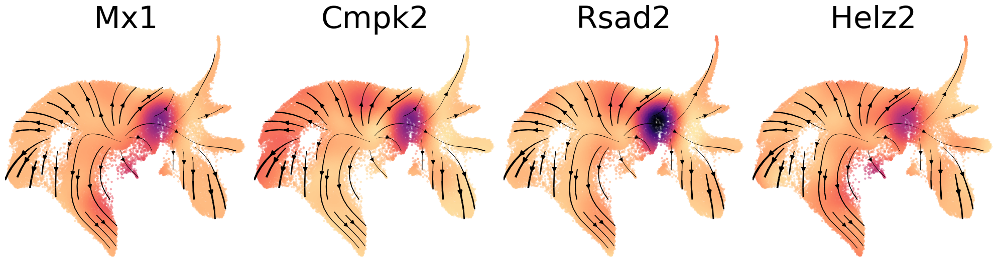

# Original LARRY embedding and gene gradients

These are byte-for-byte copies of the original notebooks, including their saved plots and execution history, from the local `vector_field_visualization` project. No analysis code, parameters, preprocessing, cell selection, or stored outputs were changed during recovery.

The tutorial-based replacement results have been removed. These recovered results were **not freshly rerun**.

| Notebook | Original source | Saved PNG outputs | Recorded Python / kernel |
| --- | --- | ---: | --- |
| [01_generate_saved_embedding.ipynb](01_generate_saved_embedding.ipynb) | `embedding_Larry.ipynb` | 42 | 3.10.20 / `scvelo` |
| [02_fp1_gene_gradient_field.ipynb](02_fp1_gene_gradient_field.ipynb) | `gradient_field_fp1_Larry.ipynb` | 15 | 3.11.15 / `python3` |
| [03_fp2_gene_gradient_field.ipynb](03_fp2_gene_gradient_field.ipynb) | `gradient_field_fp2_Larry.ipynb` | 22 | 3.12.12 / `python3` |

## Original inputs and helpers

Run from this analysis folder. The unchanged notebooks read `./data/larry/larry_processed.h5ad` and `./data/larry/larry_embedder.pkl`. Curvature notebooks additionally read `./data/larry/cospar_tmap_result.h5ad`. The local `data` link points to the original `vector_field_visualization/data` directory and is excluded from Git. The tutorial `.joblib` input is not used.

The unchanged notebooks import the original upstream `scripts.*` helpers from `vector_field_visualization/scripts`. For local verification, the `scripts` link resolves to an unchanged local helper snapshot; that snapshot and link are not published. A clone requires both the upstream helper directory as `./scripts` and the source data to be supplied locally. No datasets, pickles, or intermediate arrays are published.

Kernel labels and Python versions above are recovered notebook metadata, not a certification of the currently installed environments. In particular, the gradient notebooks both say `python3` but record different Python versions; do not substitute a single current default kernel and assume it reproduces the historical run. Several original cells set numerical thread limits to one; those settings are preserved unchanged.

## Original execution history

The embedding notebook is an exploratory record with parameter sweeps, unexecuted cells, and one stored `NameError: name 'V' is not defined` in cell index 8. This original state is retained rather than repaired or presented as a clean top-to-bottom run. The two gradient notebooks contain no stored error outputs.

## Plot previews

Every embedded PNG is exported unchanged in [original_outputs](figures/original_outputs/); the notebooks retain the complete plot sequence.

### embedding_Larry.ipynb

### gradient_field_fp1_Larry.ipynb

### gradient_field_fp2_Larry.ipynb

