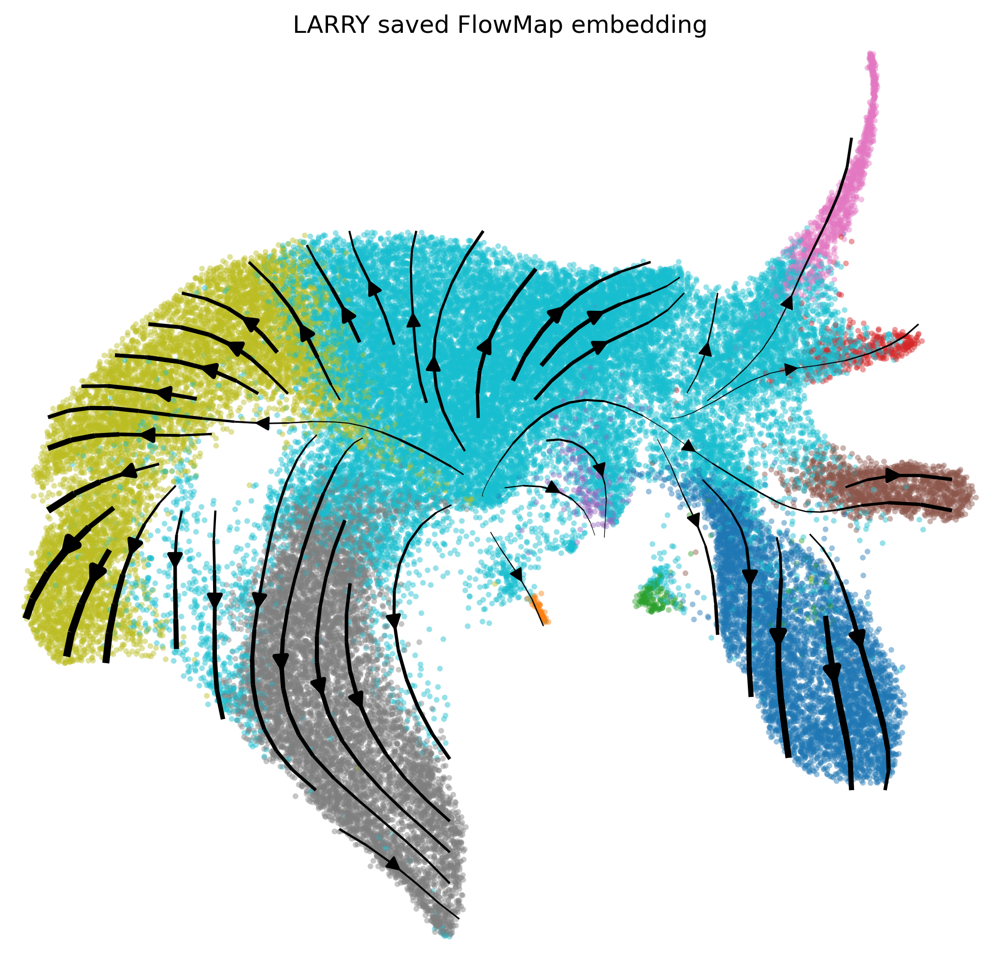
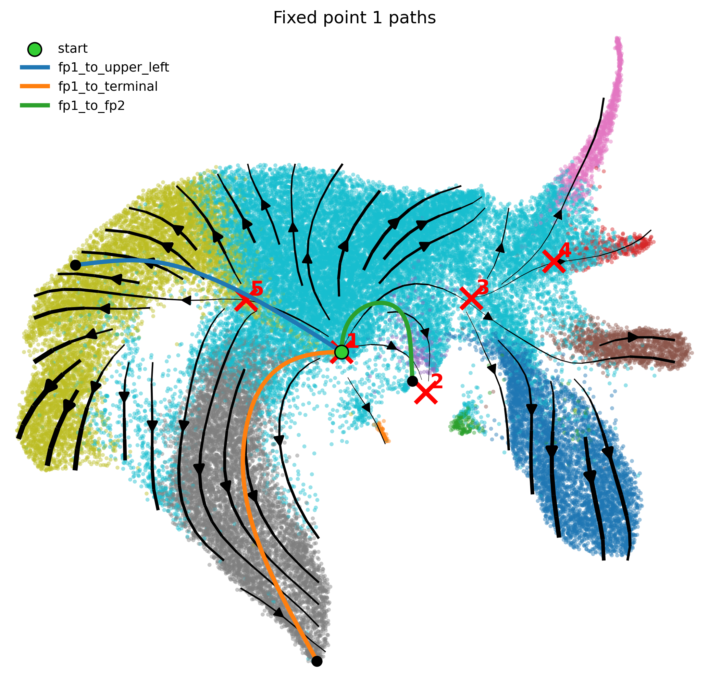
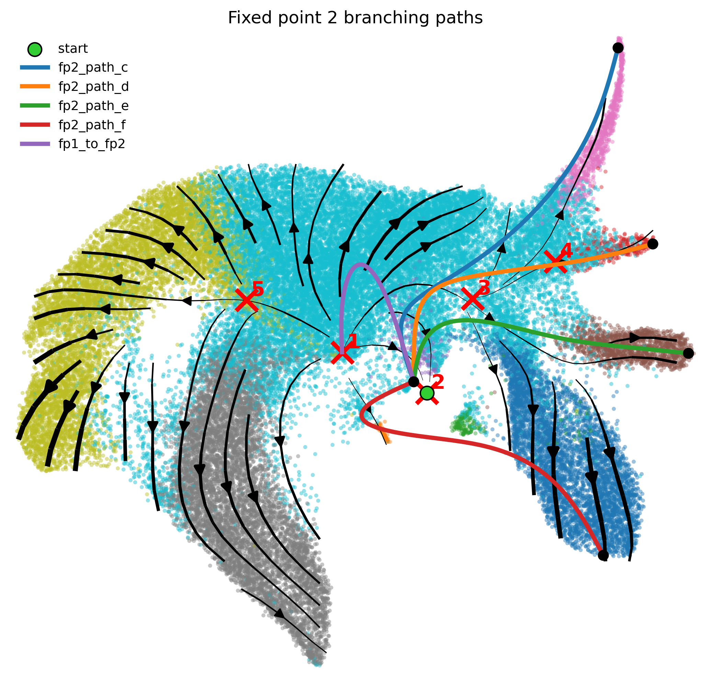

# LARRY embedding and gene gradients

The notebooks retain plots from local execution. Open a notebook to see its inline results, or browse [all saved plot images](figures/larry/). Source datasets and intermediate arrays are not included.

## Saved embedding

[Notebook with outputs](01_generate_saved_embedding.ipynb)

## Fixed point 1

[Notebook with outputs](02_fp1_gene_gradient_field.ipynb)

## Fixed point 2

[Notebook with outputs](03_fp2_gene_gradient_field.ipynb)

## Running locally

Run the notebooks one at a time from this folder using the FlowMap manuscript environment; the spline fits use multithreaded linear algebra. The input is `../data/flowmap_manuscript/larry/tutorial_larry_flowmap_data.joblib`; this file is intentionally kept local. See the root README for remaining environment and data requirements.

The gene-gradient notebooks use `flowmap_legacy/spline_evaluation.py` to evaluate the same TPS Jacobian formula in bounded matrix batches. This changes evaluation cost rather than the spline model, fit parameters, or input cells. Gradient angles returned in radians are converted to degrees for the polar plots and angle-based gene selection. A fixed random seed controls path initialization.
