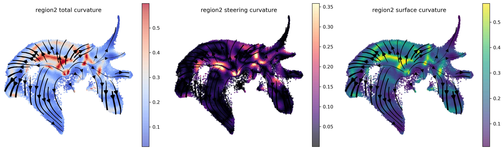

# LARRY curvature

The notebooks retain plots from local execution. Open a notebook to see its inline results, or browse [all saved plot images](figures/larry/). Source datasets and intermediate arrays are not included.

## Region 1 acceleration

[Notebook with outputs](01_curvature_region1_acceleration.ipynb)

## Region 2 fate-bias proxy

[Notebook with outputs](02_curvature_region2_fate_bias.ipynb)

## Region 3 fate-bias proxy

[Notebook with outputs](03_curvature_region3_fate_bias.ipynb)

## Running locally

Run the notebooks from this folder using the FlowMap manuscript environment. The input is `../data/flowmap_manuscript/larry/tutorial_larry_flowmap_data.joblib`; this file is intentionally kept local. See the root README for remaining environment and data requirements.
