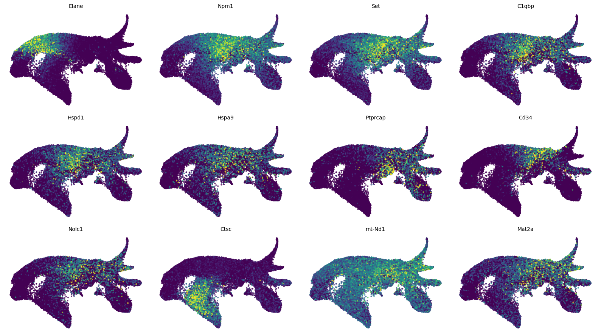
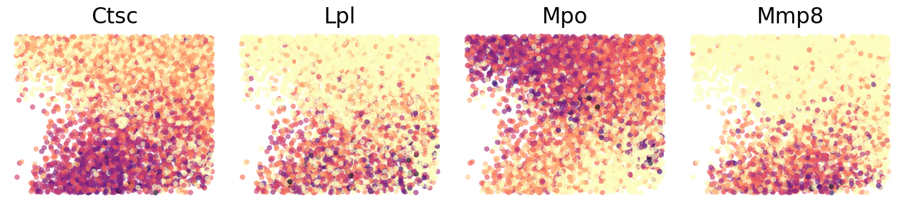
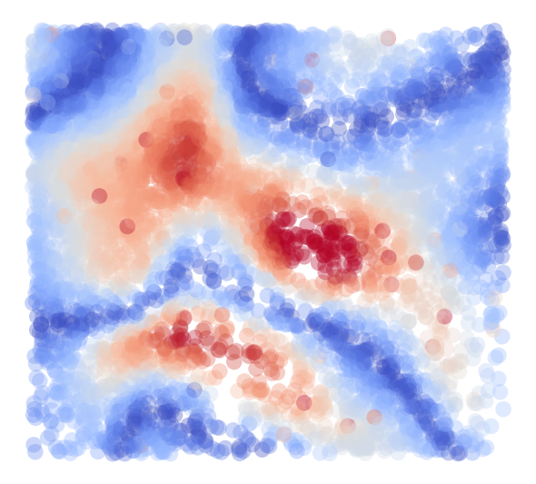

# Original LARRY curvature analyses

These are byte-for-byte copies of the original notebooks, including their saved plots and execution history, from the local `vector_field_visualization` project. No analysis code, parameters, preprocessing, cell selection, or stored outputs were changed during recovery.

The tutorial-based replacement results have been removed. These recovered results were **not freshly rerun**.

| Notebook | Original source | Saved PNG outputs | Recorded Python / kernel |
| --- | --- | ---: | --- |
| [01_curvature_region1_acceleration.ipynb](01_curvature_region1_acceleration.ipynb) | `curvature_Larry_region1.ipynb` | 23 | 3.9.23 / `cospar` |
| [02_curvature_region2_fate_bias.ipynb](02_curvature_region2_fate_bias.ipynb) | `curvature_Larry_region2.ipynb` | 17 | 3.9.23 / `cospar` |
| [03_curvature_region3_fate_bias.ipynb](03_curvature_region3_fate_bias.ipynb) | `curvature_Larry_region3.ipynb` | 17 | 3.9.23 / `cospar` |

## Original inputs and helpers

Run from this analysis folder. The unchanged notebooks read `./data/larry/larry_processed.h5ad` and `./data/larry/larry_embedder.pkl`. Curvature notebooks additionally read `./data/larry/cospar_tmap_result.h5ad`. The local `data` link points to the original `vector_field_visualization/data` directory and is excluded from Git. The tutorial `.joblib` input is not used.

The unchanged notebooks import the original upstream `scripts.*` helpers from `vector_field_visualization/scripts`. For local verification, the `scripts` link resolves to an unchanged local helper snapshot; that snapshot and link are not published. A clone requires both the upstream helper directory as `./scripts` and the source data to be supplied locally. No datasets, pickles, or intermediate arrays are published.

Kernel labels and Python versions above are recovered notebook metadata, not a certification of the currently installed environments. In particular, the gradient notebooks both say `python3` but record different Python versions; do not substitute a single current default kernel and assume it reproduces the historical run. Several original cells set numerical thread limits to one; those settings are preserved unchanged.

All three recovered curvature notebooks contain saved figures and no stored error outputs. They retain their original exploratory execution history and CoSpar fate analysis; the earlier fate-bias proxy replacements are removed.

## Plot previews

Every embedded PNG is exported unchanged in [original_outputs](figures/original_outputs/); the notebooks retain the complete plot sequence.

### curvature_Larry_region1.ipynb

### curvature_Larry_region2.ipynb

### curvature_Larry_region3.ipynb

